# Design implementation plan — portfolio v2

> Source: design critique of `http://localhost:3010/en` (2026-11-25), desktop 1440×900 and mobile 390×844.
> Score before: **7/10**. Goal: a shorter, sharper page where **Projects** is the centrepiece.
> Scope: all items of the critique. No new dependencies.

## Targets (definition of done)

| Metric | Now | Target |
|---|---|---|
| Page height, desktop 1440 | ~9 700 px | ≤ 7 000 px |
| Page height, mobile 390 | ~12 000 px | ≤ 8 000 px |
| Headline visible in the first mobile screen (390×844) | No | Yes |
| Interactive elements < 44×44 px on mobile | 10+ | 0 (visual size may stay smaller, hit area grows) |
| Next.js dev overlay issues on `/en` and `/fr` | 1 | 0 |
| Lighthouse a11y / BP / SEO | 100 | 100 (unchanged) |

## Ground rules

- All copy lives in `src/content/en.ts` **and** `src/content/fr.ts`; every copy change is made in both (types enforce parity).
- Locale-independent data (links, dates, stacks, project images) goes in `src/content/meta.ts`.
- Every clickable element keeps `cursor: pointer` (project rule in `CLAUDE.md`).
- Read `node_modules/next/dist/docs/` before touching Next APIs (`AGENTS.md`), especially `next/image`.
- Run after each phase: `pnpm lint && pnpm typecheck && pnpm test && pnpm build && pnpm test:e2e`.

## Decisions from Mario (2026-11-25)

| # | Topic | Decision |
|---|---|---|
| D1 | Screenshots | None available. Capture the **public live sites** during Phase 3 (Lavanty, Akademika, PVGIS24, Solar Rent, pyxis.site). SFER (internal) and Solar Advisor (not launched) get no screenshot. |
| D2 | Metrics | **None** — numbers are confidential. No metric field, no invented numbers. |
| D3 | Hackathons | **Keep as is**: the "6 hackathon & competition podiums" stat and the full awards list stay. Several were open to professional developers, so they show real capability. |
| D4 | Reply time | "within 24h" / "sous 24 h". |
| D5 | Testimonial | No public link (the recommendation is a PDF letter). Show author name + role only. |

---

## Phase 0 — Fix the dev overlay issue (🔴, ~30 min)

The Next dev overlay shows **"1 Issue"** on mobile and covers the hero CTA.

1. Open `/en` at 390×844, click the overlay, note the error (likely hydration mismatch: `CountUp`, theme, or the marquee).
2. Fix the root cause; check `/fr` and desktop too.
3. **Verify:** overlay gone on both locales and both viewports; console clean.

## Phase 1 — Remove repetition & shorten the page (🔴, ~half day)

### 1.1 Remove the hero tech marquee
- `src/app/[locale]/page.tsx`: drop `<TechMarquee>` and the `marqueeItems` computation.
- Delete `src/components/shared/tech-marquee.tsx` and its CSS keyframes in `src/app/globals.css` if unused elsewhere (`rg TechMarquee`, `rg marquee`).

### 1.2 Hero clean-up — `src/components/sections/hero.tsx`
- Remove the mono eyebrow span (`{siteConfig.shortName} · {hero.role}`) from the `<h1>`; the `<h1>` keeps only the headline.
  - Keep the name for SEO/screen readers via the existing `<title>` + JSON-LD; optionally an `sr-only` span "Mario Randriamanantena, full-stack engineer —" inside the h1.
  - Remove `hero.role` from `types.ts` if nothing else uses it (`rg "hero.role"`; also check `lib/seo.ts` and OG images).
- Shorten `hero.summary` (en + fr) to ≤ 2 lines at desktop:
  - EN: "Full-stack engineer shipping production SaaS, marketplaces and auction platforms with Next.js, NestJS and Laravel."
  - FR: "Ingénieur full-stack : je livre des SaaS, marketplaces et plateformes d'enchères en production, avec Next.js, NestJS et Laravel."
- Remove the hero **Download CV** secondary button? → **No**, keep it in the hero (recruiters), but remove it from Contact (see 6.3). Header keeps its CV button.

### 1.3 Stats — `content.stats` (en + fr)
- Remove "3.5+ yrs" from the summary (done in 1.2) so it lives only in stats.
- Keep the hackathon stat (D3). Optional wording tweak only: "hackathon & competition podiums" stays.
- Shorten labels: "live websites & platforms I've contributed to" → "live platforms shipped" / "plateformes en ligne livrées".

### 1.4 About → short point of view — `about.tsx`, `content.about`
- Replace the 3 paragraphs (employer history, duplicated in Experience) with **2 sentences** on how Mario works, e.g.:
  - EN: "I care about the whole product, not just the ticket: clear specs, tested business logic and fast, secure pages. I use AI-assisted development daily as an accelerator, never as a substitute for design, tests and review."
  - FR equivalent.
- Keep the 4 "Why teams work with me" pillars, but de-duplicate with Services (see 2.1).
- Layout: statement on the left (larger text, `text-xl sm:text-2xl`, no left border bars), pillars on the right.

### 1.5 Skills → compact block — `skills.tsx`
- Replace the 5 icon-tile cards with one block: a definition list (`<dl>`) of group title + inline tags, 2 columns on `lg`, no card background, no group icons.
- Remove `groupIcons` and the lucide imports.
- Target height: ≤ 400 px desktop.

### 1.6 Education → trim — `education.tsx`, `content.education`
- Remove items "Laravel framework training" and "English language course" (en + fr).
- **Hackathons & competitions: unchanged** (D3) — keep all 6 rows with their project descriptions. Only apply the shared consistency fixes (Phase 6: title sizes, 44 px targets on the linked item).
- Consider merging Education into Skills as one section "Skills & education" to remove one section header (optional, decide during implementation; nav does not list either).

### 1.7 Availability pill appears once more than needed
- Keep the hero pill. In `contact.tsx`, remove the pill (see 6.3).

**Phase 1 verification:** page heights measured (script in "Verification"), en/fr parity tests green, no orphan imports (`pnpm lint`).

## Phase 2 — Services: de-duplicate & vary the rhythm (🟡, ~2 h)

### 2.1 De-duplicate with About pillars
- About pillars = *qualities* (ownership, business logic, performance, security).
- Services = *offers*. Rename/rewrite service #4 "Performance, security & maintenance" → "Audits & maintenance": "Slow pages, heavy queries and missing tests: found, fixed and documented." (security already covered by the pillar).

### 2.2 Fix the 3+2 grid
- Option chosen: **numbered list rows** instead of cards — 2 columns on `lg`, each row: index (mono, brand), title, one-line description, thin bottom border. No icon tiles. Removes the uneven 3+2 widths and the card fatigue.
- Remove `serviceIcons`, `isLastPair` logic.
- Keep "How I work" 4 steps; equalise copy length (step 4: "Deployment, docs and follow-up after launch." / FR equivalent).

## Phase 3 — Projects as the centrepiece (🔴, ~1 day)

### 3.1 Data model — `src/content/meta.ts`
- `ProjectMeta`: add `image?: string` (path under `/public/images/projects/`).
- `ProjectItem` (`types.ts`): add `imageAlt?: string` (localized). No metric field (D2).
- Capture screenshots of the public sites (D1) with Chrome DevTools at 1440×900, light theme, top of the homepage (hide cookie banners), export to `public/images/projects/{id}.webp`, < 150 KB each. Check each capture shows no personal or customer data.

### 3.2 Card layout — `projects.tsx`
- **Featured card (index 0)**: two columns on `md+` — text left, screenshot right in a light browser frame (rounded-xl, top bar with 3 dots, `ring-1 ring-border`, subtle shadow). Larger title (`text-3xl`) and the 2 strongest highlights shown as bullets under the summary (no numbers, D2).
- **Other cards**: screenshot on top (aspect 16/10, `object-cover object-top`), then content. Cards without image (SFER, Solar Advisor) get a neutral pattern placeholder with the project icon, or no image area at all (keep heights balanced per row).
- Use `next/image` with `sizes` and `loading="lazy"` (featured: `priority` false — it's below the fold).
- Hover: slight image zoom (`group-hover:scale-[1.02]`, `motion-reduce` off).

### 3.3 Consistent actions
- "Details" and "Visit site": same height (`h-9`, mobile `h-11`), Details = `variant="outline"`, Visit site = `variant="ghost"` or `secondary` with arrow; both `Button asChild`.
- Change `ProjectDetails` trigger and `ExternalLink` usage accordingly (`project-details.tsx`).

### 3.4 Chips
- `TechList`: when tags come from `project.focus` (non-tech), render without the `</>` fallback icon (add prop `plain` or detect missing icon in `tech-icon.tsx` and render nothing instead of the code glyph).

### 3.5 Outcome-oriented copy (en + fr)
- Rewrite each project `summary` as problem → result, ≤ 140 chars, and each Experience `highlights` bullet as action → impact. **Qualitative only** (D2): e.g. "so buyers can bid live from any device", "so the sales team tracks every lead to payment" — no figures.

### 3.6 Mobile
- Keep the horizontal snap carousel but show 1.1 cards (`w-[88%]`) so the next card peeks; ensure images don't make cards taller than ~560 px.

## Phase 4 — Testimonial (🟡, ~1 h)

- Position: it already follows `<Projects>`; keep it there and fix the layout. Optional later: a one-line excerpt under the hero stats.
- `testimonial.tsx`:
  - Remove the decorative `“` span **or** the quotes from `t.common.openQuote/closeQuote` — keep only the decorative glyph (no double quote marks).
  - Two-column layout on `lg`: quote (span 8) + author card (span 4: initials, name, role). No link (D5).
  - Optional, only with Mario's and the author's OK: publish the letter as `public/recommendation.pdf` and add "Read the full letter (PDF)".
  - Shorten section padding (`py-14 sm:py-16`).

## Phase 5 — Mobile & touch targets (🔴, ~2 h)

### 5.1 Hero order on mobile — `hero.tsx`
- Remove `order-first` on mobile; show the headline first.
- Mobile portrait: small avatar (`size-20`, rounded-full) inline with the availability pill, hide the large portrait + offset frame below `lg`. Large portrait only on `lg+`.

### 5.2 Hit areas ≥ 44 px on touch devices
Files: `locale-switcher.tsx`, `theme-toggle.tsx`, `mobile-nav.tsx`, `project-details.tsx`, `external-link.tsx` usages, `social-links.tsx`, `skip-link.tsx` (focus only, fine).
- Approach: larger padding/size on touch devices only (`pointer-coarse:size-11` / `pointer-coarse:h-11`, Tailwind 4 variant), so the desktop look is unchanged. Where layout can't grow, add an invisible `::after` hit area (`relative after:absolute after:-inset-2`).
- Targets: EN/FR (36×24), theme toggle (28×28), menu (28×28), Details (64×28), Visit site (74×20), "other live sites" links (24 px), experience company links (28 px).

### 5.3 Mobile length
- Phase 1 + compact Skills/Education already cut most. Also reduce `Section` vertical padding on mobile (`src/components/shared/section.tsx`: e.g. `py-16` → `py-12` below `sm`).

## Phase 6 — Consistency & contact polish (🟡/🟢, ~2 h)

### 6.1 Typography scale
- Card/item titles: only two sizes — `text-base font-semibold` (default) and `text-2xl/3xl` (featured project). Audit h3 in `about`, `services`, `experience`, `education`, `projects` (`rg "<h3" src/components`).

### 6.2 Headline highlight — `highlighted-text.tsx`, `lib/highlight.ts`
- One treatment for all highlighted words: same gradient (`from-brand to-brand-2`) applied per word, or highlight **only "SaaS and marketplace"** as one span. Update `tests/highlight.test.ts` if the API changes.

### 6.3 Contact — `contact.tsx`, `contact-form.tsx`, `content.contact`
- Remove the availability pill and the Download CV button from the left column (CV is in header + hero).
- Intro (en + fr): "Tell me about your project or role. I reply within 24h." / "Parlez-moi de votre projet ou du poste. Je réponds sous 24 h." (D4).
- Textarea: `field-sizing-content` in `ui/textarea.tsx` ignores `rows={6}`; add `className="min-h-36"` on the contact textarea.
- Form card: `lg:self-start` so it doesn't stretch to the left column height, or let the textarea grow (`flex-1`) to fill — choose `self-start` + taller textarea.

### 6.4 Experience — `experience.tsx`
- Narrow the date column (`lg:grid-cols-[9rem_1fr]`) or put the date above the role on all sizes.
- Move "(FINAMAD)" from the company name to the location/subtitle line (content en + fr).

### 6.5 Hero portrait frame
- Replace the offset teal outline (`drift` frame) with a simple rounded image + soft shadow; drop the `drift` animation if unused elsewhere.

### 6.6 Name consistency — `site-footer.tsx`
- Footer: `siteConfig.shortName` ("Mario Randriamanantena"). Keep `siteConfig.name` (official order) for JSON-LD / CV only. Update README tagline if desired.

### 6.7 Contrast check
- Check with axe + manual: teal mono eyebrows (12 px) on `bg-background` and `bg-muted`, muted chip text, both themes. If < 4.5:1, darken `--brand` text variant (add `--brand-text` token in `globals.css`).

---

## Suggested order & estimates

```mermaid
gantt
  dateFormat  X
  axisFormat %s
  section Must
  P0 dev overlay        :p0, 0, 1
  P1 cut repetition     :p1, after p0, 4
  P5 mobile & targets   :p5, after p1, 2
  section High impact
  P3 projects visuals   :p3, after p5, 8
  section Polish
  P2 services           :p2, after p1, 2
  P4 testimonial        :p4, after p3, 1
  P6 consistency        :p6, after p4, 2
```


(units ≈ hours; no external blockers left)

## Verification

Per phase:
1. `pnpm lint && pnpm typecheck && pnpm test`
2. `pnpm build && pnpm test:e2e` (axe runs in both themes/locales).
3. Visual check with Chrome DevTools at 1440×900 and 390×844, en + fr, light + dark.
4. Page height + small-target audit (paste in the console):
   ```js
   ({ h: document.body.scrollHeight,
      small: [...document.querySelectorAll('a,button')].filter(e => { const r = e.getBoundingClientRect(); return r.width && (r.width < 44 || r.height < 44) }).length })
   ```
5. Cursor rule: `[...document.querySelectorAll('a,button,[role=button]')].filter(e => getComputedStyle(e).cursor !== 'pointer')` → empty.

### Tests to add/update
- `tests/content.test.ts`: every project with `meta.image` has `imageAlt` in both locales.
- `e2e/site.spec.ts`: h1 contains only the headline text; on mobile viewport the h1 is in the first viewport (`boundingBox().y < 844`); project details dialog still opens with the new button.

## Out of scope
- New sections, blog, case-study pages (could follow Phase 3 as `/[locale]/projects/[id]`).
- Brand/colour redesign.
